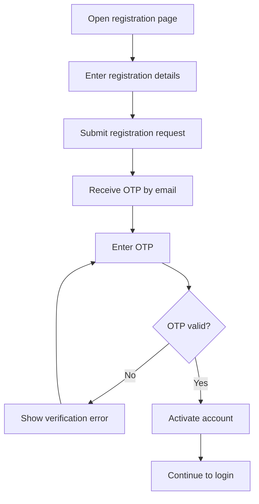

# University Platform

A university-focused web application that provides a simple account registration and sign-in experience for students and other eligible users.

The project is being developed to make university account onboarding clearer and more reliable through email-based verification.

## Overview

The registration flow is designed around a university email address and a one-time password (OTP). After the user submits the registration details, the application requests an OTP, verifies it, and proceeds with account activation.

## Registration workflow



## Current application flow

- Registration form for creating a university platform account.
- University email-based OTP verification.
- OTP validation before account activation.
- Navigation to the login flow after successful verification.
- User-facing handling for API and verification errors.

> **Note:** This README documents the intended/current application flow based on the project description. Exact API routes, backend framework, database, and deployment details will be added once those implementation details are available in the repository.

## Technology

| Area | Technology |
| --- | --- |
| Frontend | React |
| Backend | Backend API (implementation details to be documented) |
| Communication | HTTP / REST API |
| Verification | Email OTP |

## Project structure

The source-code structure has not yet been documented. Update this section when the frontend and backend directories are available.

A suggested structure (not a claim about the current repository):

```text
universityplatform/
├── frontend/
├── backend/
├── docs/
└── README.md
```

## Getting started

The repository currently does not provide enough source-code or configuration information to publish reliable installation and run commands.

Once the application source is added, include:
1. Required software versions.
2. Installation commands for each application component.
3. Environment variable names (never commit real secrets).
4. Database and email-service setup, if applicable.
5. Local development and test commands.

## Security considerations

- OTPs should be short-lived and accepted only for the intended registration session.
- OTP verification should be enforced by the backend, not only by frontend checks.
- Sensitive values such as API keys, email credentials, and database passwords must be stored in environment variables or a secrets manager.
- Production deployments should use HTTPS and appropriate rate limiting for OTP requests and verification attempts.

These are implementation recommendations; they are not a security-audit certification.

## Roadmap

- [ ] Document the frontend and backend setup.
- [ ] Add API documentation and environment-variable examples.
- [ ] Add automated tests for registration and OTP verification.
- [ ] Document deployment steps.
- [ ] Add screenshots of the application.

## Contributing

Contributions and suggestions are welcome. Before submitting a change, describe the issue being addressed and include relevant test results where available.

## License

A license has not yet been specified. Add a `LICENSE` file before distributing the project under an open-source license.

---

**Repository:** [Lohi11/universityplatform](https://github.com/Lohi11/universityplatform)
